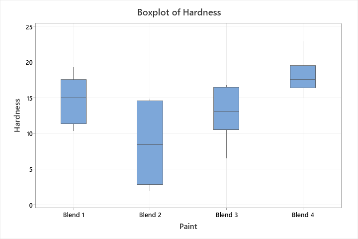

# Statistical Quality Control with Minitab

**Six case studies in statistical comparison, equivalence testing, and process monitoring.**

[English report](reports/quality-control-report-en.md) · [Figure gallery](docs/FIGURES.md) · [Combined Minitab project](minitab/complete-analysis.mpx) · [Worksheet guide](data/README.md)

An individual undergraduate Quality Control project by Salva Daneshvar at Sharif University of Technology. The cases show how to choose a statistical method for paired measurements, attribute data, defect counts with varying inspection opportunity, and individual measurements.

## Case studies

| Case | Methods and outputs | Minitab project |
| --- | --- | --- |
| 1. Paint hardness | Descriptive statistics, normality assessment, analysis of variance (ANOVA), and regression for formulation, curing temperature, and operator | [Paint hardness](minitab/01-paint-hardness.mpx) |
| 2. Cleaning solutions | Paired equivalence testing for mean contact angle | [Cleaner equivalence](minitab/02-cleaner-equivalence.mpx) |
| 3. Attribute monitoring | Run charts, p and np control charts, and count-based and cost-weighted Pareto summaries | [Attribute control and Pareto](minitab/03-attribute-control-and-pareto.mpx) |
| 4. Defects per unit | u chart and run chart for weak spots in wires of varying lengths | [Defects per unit](minitab/04-defects-per-unit.mpx) |
| 5. Individual observations | Individuals and moving-range (I-MR) charts with additional tests for unusual patterns | [Individual observations](minitab/05-individual-observations.mpx) |
| 6. Baseline and follow-up samples | Phase I and Phase II p charts, cause-category summaries, and binomial outputs | [Phase I and II](minitab/06-phase-one-and-phase-two.mpx) |

## Selected results

- **Paint hardness.** Blend 4 had the highest observed mean hardness among four formulations. The one-way ANOVA indicated an overall difference among formulation means ($F(3,20)=6.02$, $p=0.004$).
- **Cleaning solutions.** The two one-sided tests on 14 matched pairs supported equivalence in mean contact angle within the prespecified margin of ±0.5 degrees.

## Explore the files

| Folder | Contents |
| --- | --- |
| [`reports/`](reports) | Main English report and the [supplementary Persian course report](reports/original/course-report-fa.pdf) |
| [`minitab/`](minitab) | Six case-specific Minitab projects and one combined project |
| [`data/`](data) | [Worksheet values in JSON](data/worksheets.json), including saved input and derived columns |
| [`docs/`](docs) | [Case-to-worksheet map](docs/FILES.md) and [figure gallery](docs/FIGURES.md) |
| [`assets/figures/`](assets/figures) | Chart images reproduced from the course report |

Open the `.mpx` files in a compatible Minitab desktop installation to inspect the saved worksheets and analysis outputs. The English report, figures, and JSON worksheet export can be viewed directly on GitHub.
