# Minitab output gallery

Charts and statistical output reproduced from the [course report](../reports/original/course-report-fa.pdf). Image filenames retain the source PDF page and figure numbers. Read the [English report](../reports/quality-control-report-en.md) for the corresponding methods and interpretation.

## Paint hardness

**Hardness by paint formulation**

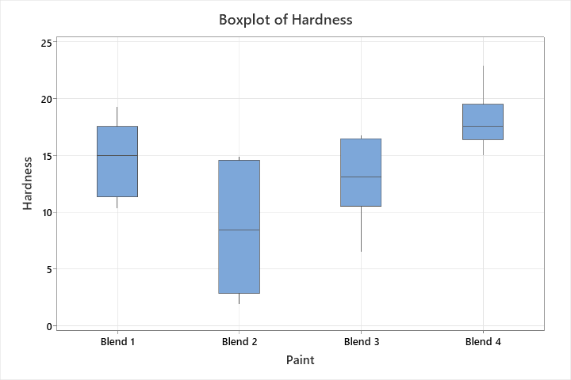

**Hardness histograms by formulation**

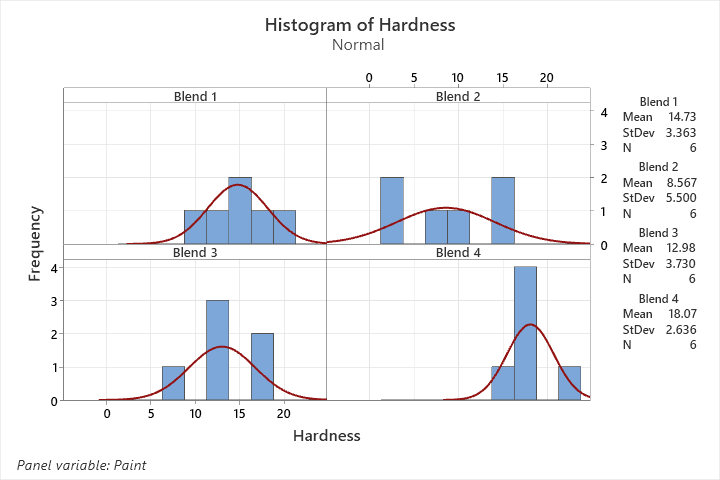

**Descriptive statistics and distribution for Blend 1**

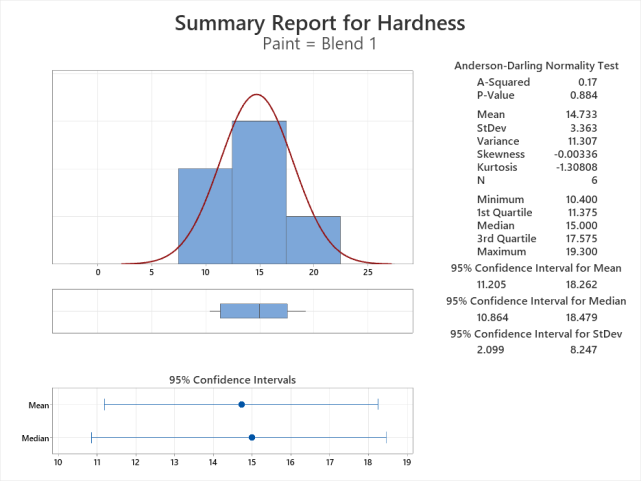

**Descriptive statistics and distribution for Blend 2**

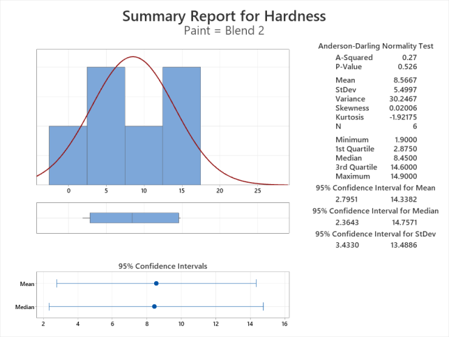

**Descriptive statistics and distribution for Blend 3**

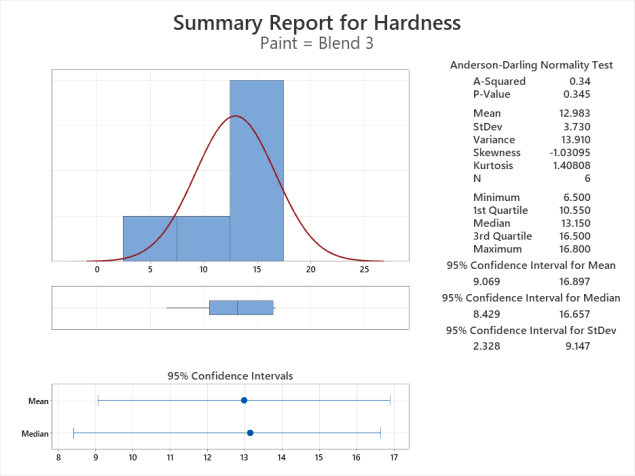

**Descriptive statistics and distribution for Blend 4**

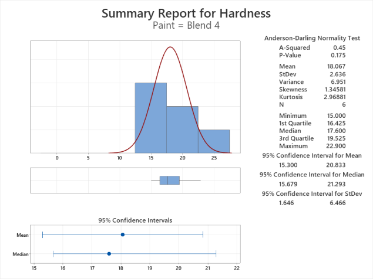

**Interval plot of hardness by formulation**

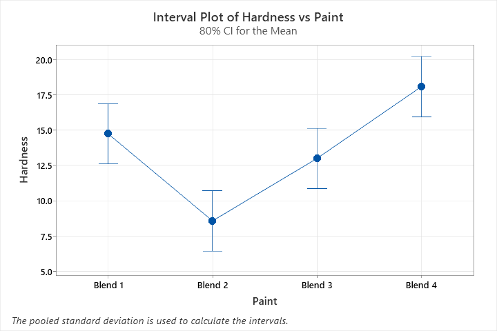

**Normal probability plot from the paint analysis**

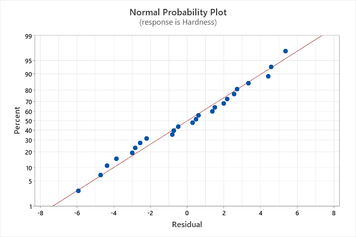

**Normal probability plot from the operator-adjusted analysis**

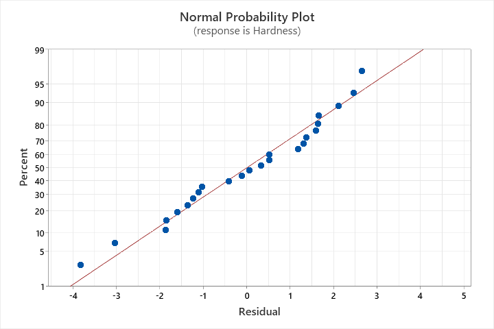

## Cleaning solution equivalence

**Contact angle by cleaning solution**

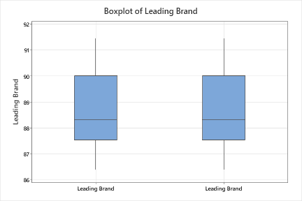

**Distribution of paired differences**

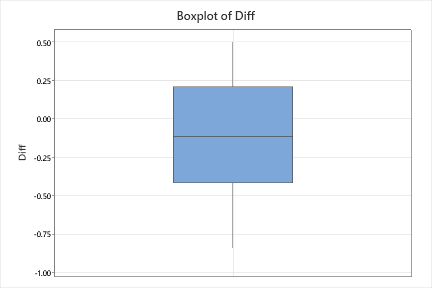

**Paired equivalence test for mean contact angle**

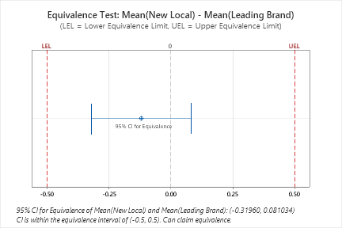

## Attribute monitoring and Pareto analysis

**Run chart of the baseline proportions**

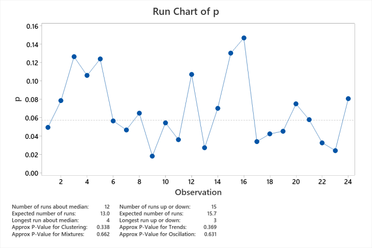

**Initial baseline p chart**

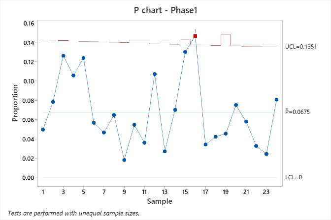

**Baseline p chart used for follow-up**

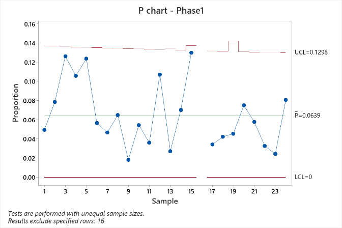

**Baseline p chart for Machine 1**

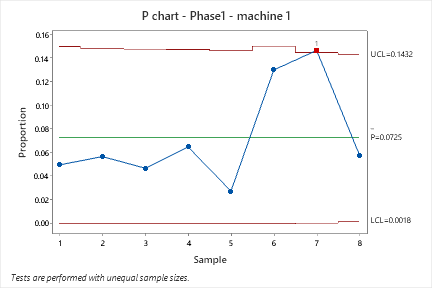

**Baseline p chart for Machine 2**

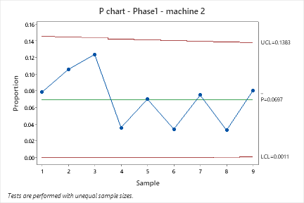

**Baseline p chart for Machine 3**

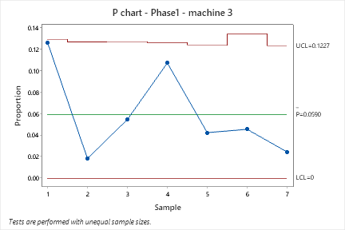

**Standardized chart**

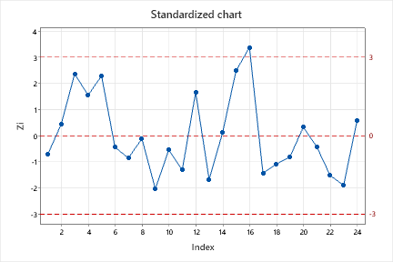

**Standardized chart with the flagged observation excluded**

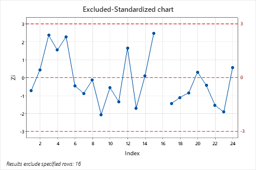

**Run chart of the follow-up proportions**

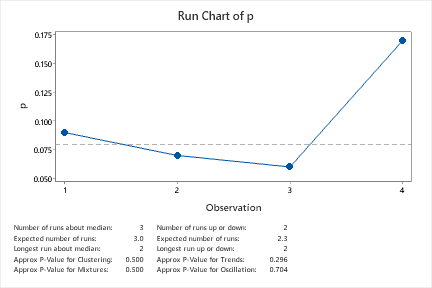

**Follow-up p chart**

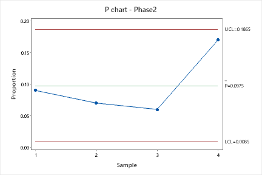

**Follow-up np chart**

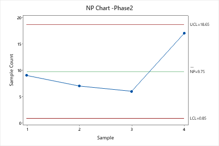

**Pareto chart by machine**

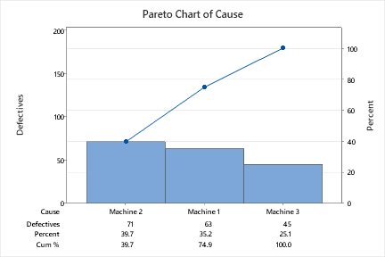

## Defects per unit

**Initial u chart for weak spots**

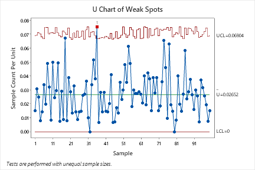

**Revised u chart for weak spots**

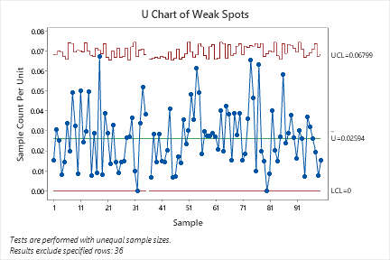

**Run chart of the defect rate**

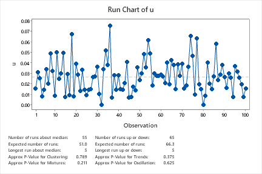

## Individual observations

**Run chart of individual measurements**

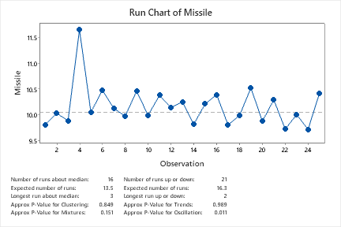

**First individuals and moving-range chart**

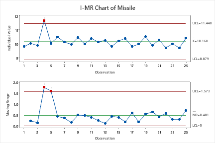

**Second individuals and moving-range chart**

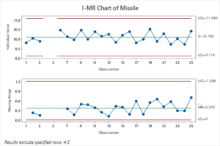

**Individuals and moving-range chart with additional tests, first display**

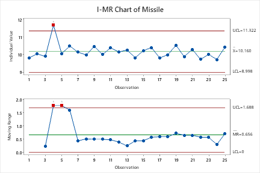

**Individuals and moving-range chart with additional tests, second display**

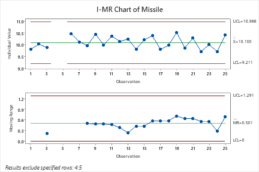

**Individuals and moving-range chart with additional tests, third display**

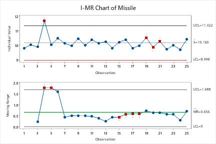

**Individuals and moving-range chart with additional tests, fourth display**

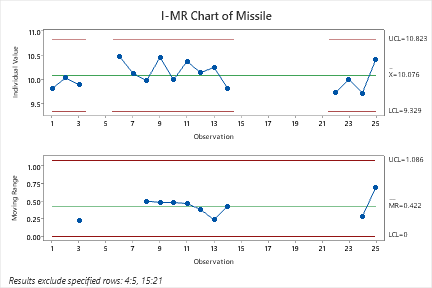

## Baseline and follow-up attribute samples

**Initial Phase I p chart**

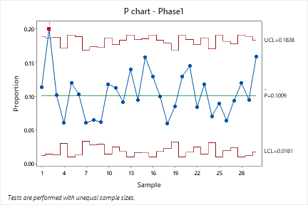

**Phase I p chart used for follow-up**

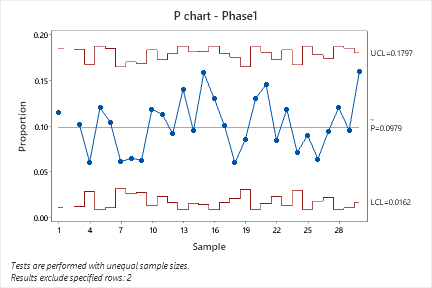

**Phase II p chart**

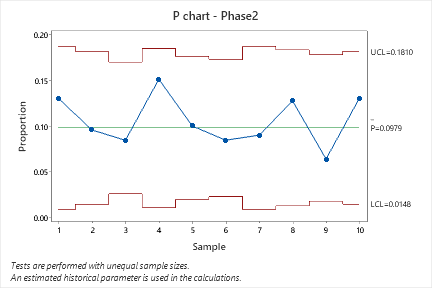

**Pareto chart of baseline subgroup cause labels**

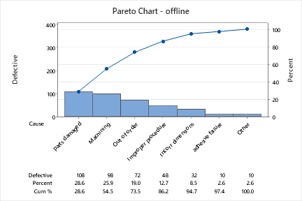

**Pareto chart of follow-up subgroup cause labels**

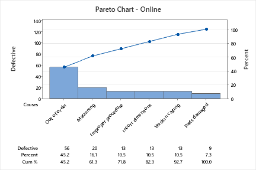

**First binomial process summary**

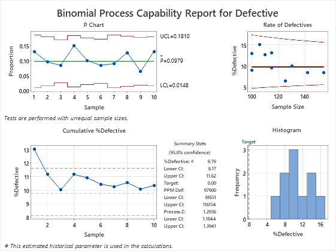

**Second binomial process summary**

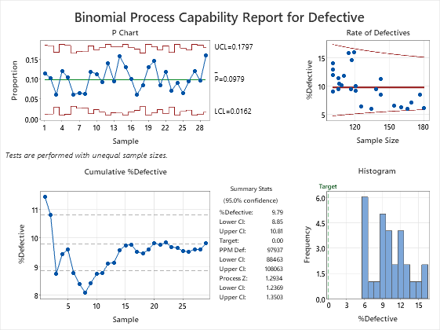
