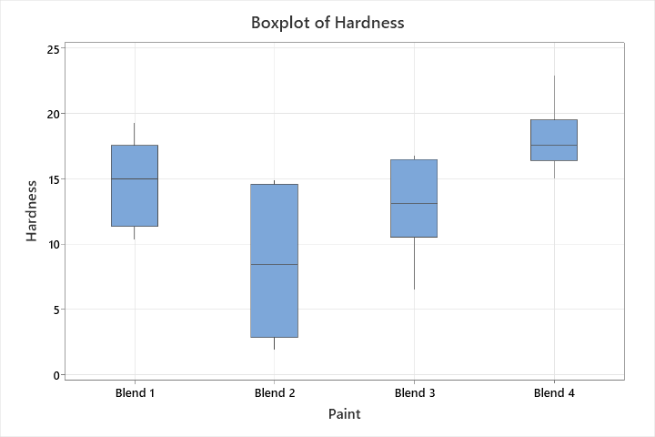
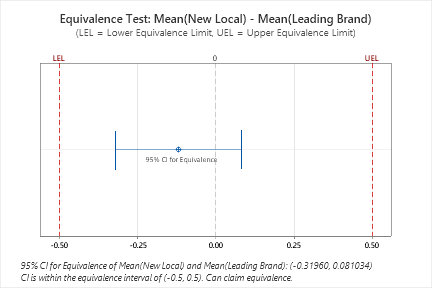

# Statistical quality control: six Minitab case studies

**Salva Daneshvar**  
Undergraduate Quality Control · Sharif University of Technology · Academic year 1404  
Instructor: Dr. Rafiei

[Project overview](../README.md) · [Output gallery](../docs/FIGURES.md) · [File guide](../docs/FILES.md)

## Abstract

This course project used Minitab to examine six quality-control cases involving material comparisons, a paired equivalence study and process-monitoring data. Descriptive statistics, analysis of variance, regression, run charts, control charts and Pareto summaries addressed different statistical questions. Among four paint formulations, Blend 4 had the highest observed mean hardness, while one-way analysis of variance indicated differences among the formulation means. In 14 paired cleaning comparisons, the two one-sided tests supported equivalence within a contact-angle margin of ±0.5 degrees. The process-monitoring cases presented saved outputs for attribute counts, varying inspection opportunity, individual observations and baseline/follow-up samples. Together, the cases demonstrate the importance of matching an analysis to the observation structure and distinguishing observed differences, statistical evidence and process interpretation.

## 1. Objectives and material

The assignment called for concise industrial-style reporting using Minitab. The six questions covered comparisons between materials or methods and the interpretation of time-ordered process observations. The submitted work includes one combined Minitab project, six case-specific project files and a Persian report.

This English report presents the cases and the statistical findings recorded in those materials. Numerical results below are drawn from the supplied report and saved outputs. Figures are reproduced from the report; the Minitab projects retain the associated worksheets and analysis state.

| Case | Observation structure | Main statistical question |
| --- | --- | --- |
| 1 | 24 observations: four paint formulations, with temperature and operator recorded | How do hardness measurements differ across formulations and recorded conditions? |
| 2 | 14 paired measurements comparing cleaning solutions | Is the mean paired difference within a prespecified equivalence margin? |
| 3 | Baseline attribute subgroups, machine categories and follow-up observations | What do the control-chart and category summaries show? |
| 4 | 100 inspected wires, with weak spots and length recorded | How does the number of defects relate to varying inspection opportunity? |
| 5 | 25 time-ordered individual observations | What patterns appear in the saved individual and moving-range charts? |
| 6 | 30 baseline and ten follow-up attribute subgroups | How do baseline and follow-up chart outputs compare? |

The full saved worksheet values are available in [worksheets.json](../data/worksheets.json). The [file guide](../docs/FILES.md) maps each case to its native project and worksheet names.

## 2. Case 1: paint formulation, hardness and curing temperature

### 2.1. Descriptive results

Each formulation had six observations. The analysis summarized hardness and curing temperature using the mean, standard deviation, median, quartiles and observed range. Hardness is reported on the course dataset's measurement scale.

| Formulation | n | Mean hardness | SD | Median | Minimum | Maximum | Mean temperature |
| --- | ---: | ---: | ---: | ---: | ---: | ---: | ---: |
| Blend 1 | 6 | 14.7333 | 3.3625 | 15.00 | 10.4 | 19.3 | 29.8333 |
| Blend 2 | 6 | 8.5667 | 5.4997 | 8.45 | 1.9 | 14.9 | 29.7333 |
| Blend 3 | 6 | 12.9833 | 3.7296 | 13.15 | 6.5 | 16.8 | 30.0500 |
| Blend 4 | 6 | 18.0667 | 2.6364 | 17.60 | 15.0 | 22.9 | 30.2333 |

Blend 4 had the highest observed mean and median hardness and the smallest sample standard deviation. Blend 2 had the lowest observed mean and the greatest sample dispersion. These summaries describe the observations; their inferential comparison is considered separately below.

Boxplots and histograms illustrated differences in location and spread. Anderson–Darling tests and normal probability plots were used to assess the hardness distributions within formulations. The recorded tests had p-values above 0.05. They did not provide sufficient evidence to reject normality in these samples of six observations per formulation.

### 2.2. Formulation comparison

A one-way analysis of variance (ANOVA) compared mean hardness among the four formulations. The recorded result was $F(3,20)=6.02$, $p=0.004$. Thus, the overall null hypothesis of equal formulation means was rejected at the assignment's significance level of 0.20, corresponding to 80% confidence.

The saved Fisher least significant difference grouping table used 95% confidence:

| Formulation | Mean hardness | Fisher grouping |
| --- | ---: | --- |
| Blend 4 | 18.07 | A |
| Blend 1 | 14.73 | A, B |
| Blend 3 | 12.98 | B, C |
| Blend 2 | 8.57 | C |

Means without a shared letter differ at the confidence level shown in that table. Blend 4 had the highest sample mean and was separated from Blends 2 and 3 in this grouping; it shared a group with Blend 1. The overall ANOVA and the pairwise grouping answer related but distinct questions.

### 2.3. Temperature and formulation

A regression model included temperature, formulation and their interaction. The recorded overall model test had $p=0.016$. The temperature term had $p=0.977$, the formulation term $p=0.147$, and the temperature-by-formulation interaction $p=0.170$.

At a 0.05 significance level, the individual temperature and interaction tests did not show clear evidence of their respective effects. The formulation and interaction p-values should be read with the chosen significance threshold stated explicitly; the 0.20 threshold in the mean-comparison question was specific to that question. The residual probability plot was also examined as a model diagnostic.

### 2.4. Operator-adjusted model

The next regression added operator to the temperature/formulation model. The recorded operator term was significant, with $F=15.78$ and $p<0.001$. Relative to Operator 1, the fitted coefficients were −7.94 for Operator 2 and −3.92 for Operator 3; their reported p-values were below 0.001 and 0.015, respectively. These are adjusted associations within the specified model and observed conditions.

The coursework also considered formulation selection under variable curing temperatures. Blend 4 combined the highest observed hardness mean with the lowest observed sample dispersion. Those descriptive findings support its prominence in this sample; the regression results describe the temperature range actually observed.

Saved project: [paint hardness](../minitab/01-paint-hardness.mpx).

## 3. Case 2: paired comparison of cleaning solutions

### 3.1. Study design and descriptive results

The case compared a new local cleaning solution with a leading brand using 14 matched pairs. Each pair provided one contact-angle observation for each solution. Matching was retained in the analysis because the two measurements belonged to the same experimental pair.

| Solution | n | Mean contact angle, degrees | SD, degrees | Median, degrees | Range, degrees |
| --- | ---: | ---: | ---: | ---: | --- |
| Leading brand | 14 | 88.7236 | 1.5907 | 88.335 | 86.40–91.46 |
| New local solution | 14 | 88.6043 | 1.5578 | 88.535 | 85.94–91.10 |

Boxplots were presented for the two solutions and their paired differences. The difference was defined as **new local solution minus leading brand**. The observed mean difference was approximately −0.1193 degrees.

### 3.2. Equivalence analysis

The prespecified equivalence margin was ±0.5 degrees. The hypotheses were:

$$H_0:\ \mu_D\le-0.5\ \text{or}\ \mu_D\ge0.5,$$

$$H_1:\ -0.5<\mu_D<0.5.$$

Here $\mu_D$ is the mean paired difference in degrees. The two one-sided tests were evaluated at a significance level of 0.05.

| Boundary tested | Degrees of freedom | t statistic | Reported p-value |
| --- | ---: | ---: | ---: |
| Lower boundary, −0.5 degrees | 13 | 3.3657 | 0.003 |
| Upper boundary, +0.5 degrees | 13 | −5.4748 | <0.001 |

Both one-sided null hypotheses were rejected. The larger p-value, 0.003, supported equivalence under the stated margin. The Minitab equivalence plot also placed its displayed interval inside those bounds.

This conclusion concerns equivalence in mean contact angle for the matched experimental observations. It addresses the prespecified equivalence question directly.

Saved project: [cleaner equivalence](../minitab/02-cleaner-equivalence.mpx).

## 4. Case 3: attribute monitoring and Pareto summaries

This case brought together a baseline series, three machine categories and a follow-up series. The submitted analysis included a run chart of the observed proportions, p charts, a standardized chart, machine-specific displays and p/np outputs for the follow-up observations.

### 4.1. Saved monitoring outputs

The initial run-chart tests did not reject the tested random-pattern hypotheses at the conventional significance level. The control-chart analysis reported a baseline signal and presented both initial and revised chart outputs. The saved standardized display expressed observations relative to their chart centers and limits on a common scale.

Machine-specific charts separated the pooled observations into the three recorded categories. The follow-up outputs used the established baseline setting in the submitted analysis and showed no points outside the displayed control limits. The original project and [gallery](../docs/FIGURES.md) retain these displays in their report order.

### 4.2. Frequency and cost views

The count-based Pareto summary ranked Machine 2 first, followed by Machine 1 and Machine 3. A separate cost-weighted summary used the case's repair-cost assumptions and reported a different ordering: Machine 1, Machine 2, then Machine 3.

The two displays illustrate that a frequency ranking and a cost ranking describe different quantities. The reported numerical outputs are retained in the native project and supplementary report.

Saved project: [attribute control and Pareto](../minitab/03-attribute-control-and-pareto.mpx).

## 5. Case 4: defects with varying inspection opportunity

The dataset contained 100 wire observations, with weak-spot counts and wire length recorded. The submitted work used a u chart to display defects relative to the corresponding inspection opportunity. This treated a wire's defect count and its inspected length as separate recorded quantities.

The report presented the initial chart and a revised display, followed by a run chart of the defect-rate series. Its run-chart tests did not reject the tested clustering, trend or oscillation hypotheses at the conventional significance level.

The case demonstrates the distinction between counting defects and classifying an entire inspected item as defective. The saved outputs and worksheet retain the observations and derived defect-rate column used in the report.

Saved project: [defects per unit](../minitab/04-defects-per-unit.mpx).

## 6. Case 5: individual observations and moving ranges

The fifth case used 25 time-ordered individual observations. Its report included an initial run chart, individual/moving-range (I-MR) outputs with moving-range lengths of two and three, and outputs with additional sensitizing tests.

The submitted displays identified signals in both individual values and moving ranges. The additional tests highlighted patterns beyond isolated points outside the three-standard-deviation limits. Initial and later chart states are reproduced in the [gallery](../docs/FIGURES.md); the native project retains their saved analysis settings.

This section documents the existing coursework outputs. The case adds an individual-observation perspective to the attribute and varying-opportunity examples elsewhere in the project.

Saved project: [individual observations](../minitab/05-individual-observations.mpx).

## 7. Case 6: baseline and follow-up attribute samples

The final case contained 30 baseline subgroups and ten follow-up subgroups. The report presented p-chart outputs for both sets, category summaries and binomial-analysis displays. It also retained a separate worksheet for the revised baseline used in the submitted chart analysis.

### 7.1. Monitoring and category summaries

The original baseline display contained a signal; the report then presented its revised baseline and follow-up charts. The follow-up points were within the limits displayed in that report. The saved projects preserve the baseline and follow-up worksheets as separate records.

The category summaries used the recorded subgroup-level cause labels. A label describing the most frequent cause in a subgroup represents that subgroup's reported category. Its frequency is therefore a frequency of subgroup labels; it is distinct from a count of every individual defect by cause.

### 7.2. Interpretation of the supplied output

The binomial outputs describe nonconforming-item proportions and their uncertainty. The report's baseline estimate was approximately 9.8%. This is an attribute summary. Dimensional capability indices such as $C_p$ and $C_{pk}$ describe a different measurement-based analysis and should be interpreted with the relevant dimensional observations and specification limits.

Saved project: [phase-one and phase-two analysis](../minitab/06-phase-one-and-phase-two.mpx).

## 8. Statistical interpretation across cases

The six cases connect the statistical question to the observation structure. The paint study separates sample summaries, an overall comparison and adjusted regression terms. The cleaning study retains matching and evaluates a prespecified equivalence interval. The monitoring examples distinguish attribute proportions, defects per unit and individual values.

The report also uses explicit interpretations for different outputs. A normality test with a large p-value does not establish that a population distribution is normal. An overall ANOVA result does not identify every pairwise difference. A chart with no displayed signal describes the observations and settings used in that chart. A count-based category ranking and a cost-weighted ranking answer different questions.

These distinctions support concise reporting that connects each stated conclusion to its corresponding test, chart or recorded summary.

## 9. Supporting material

- [Complete saved Minitab analysis](../minitab/complete-analysis.mpx)
- [Case and worksheet guide](../docs/FILES.md)
- [Saved figure gallery](../docs/FIGURES.md)
- [Portable worksheet values](../data/worksheets.json)
- [Supplementary Persian report](original/course-report-fa.pdf)

The project uses course-provided case data. The saved files and figures document the submitted Minitab analyses; the portable export copies the stored worksheet values.
